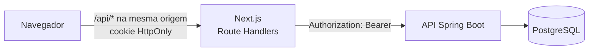

# API de Finanças Pessoais

[](https://github.com/MatheusCavalcanteF/api-financas-pessoais/actions/workflows/ci.yml)

Aplicação full stack de controle financeiro: transações, categorias, importação de extratos bancários (CSV e OFX) com deduplicação, categorização automática por palavra-chave e relatório mensal para dashboard. A API fica na raiz do repositório e a interface web em [`frontend/`](./frontend).

**Backend:** Java 25 · Spring Boot 4.1 · Spring Security + JWT · PostgreSQL 16 · Flyway · Testcontainers

**Frontend:** Next.js 16 · React 19 · TypeScript · Tailwind CSS · Playwright

## Destaques

- **Importação de extratos** CSV (formato brasileiro ou com ponto decimal) e OFX 1.x/2.x, com o formato detectado pelo conteúdo. Reimportar o mesmo extrato não duplica nada: a deduplicação usa o `FITID` do banco ou um hash do lançamento, gravada com `ON CONFLICT DO NOTHING` em lote.
- **Categorização automática** por regras de palavra-chave que ignoram maiúsculas e acentos, aplicadas na importação ou retroativamente.
- **Relatório mensal** agregado no banco numa única consulta, para os números do dashboard baterem entre si.
- **Isolamento entre usuários** garantido em todas as consultas e coberto por testes de integração.
- **Segurança tratada como requisito**, do armazenamento das senhas aos headers HTTP (veja [Decisões de segurança](#decisões-de-segurança)).
- **CI** no GitHub Actions a cada pull request: testes de integração do backend com PostgreSQL real (Testcontainers), lint e build do frontend e testes E2E com Playwright.

## Arquitetura



O navegador nunca fala direto com a API. Os Route Handlers do Next guardam o JWT num cookie `HttpOnly` e repassam para o backend só os recursos que o app usa. Por isso a API não precisa de CORS e o token nunca chega ao JavaScript. Detalhes em [`frontend/README.md`](./frontend/README.md).

## Decisões de segurança

| Tema | Como foi tratado |
| --- | --- |
| Segredos | `.env` fora do git. `JWT_SECRET` e `DB_PASSWORD` não têm valor padrão: sem eles a aplicação não sobe, e um segredo JWT com menos de 256 bits é recusado na inicialização. |
| Senhas | BCrypt, com limite de 72 bytes validado na entrada. Os DTOs de login e cadastro mascaram a senha no `toString()`, para ela não vazar em log. |
| Autenticação | JWT assinado com HMAC-SHA, com emissor e expiração (2h), validado a cada requisição. O login leva o mesmo tempo para e-mail cadastrado ou não, então não revela quais contas existem. |
| Força bruta | Limite de tentativas por IP e bloqueio por e-mail + IP, com `429` e `Retry-After`. Veja [Rate limit](#rate-limit). |
| Acesso a dados de outro usuário (IDOR) | Toda consulta filtra pelo usuário do token, que nunca vem de parâmetro ou corpo. Recurso de outro usuário responde `404`, igual a um inexistente. Coberto pelo `DataIsolationTest`. |
| Mass assignment | Entrada só por DTOs explícitos. O perfil (`role`) nunca vem do payload: todo cadastro público é `USER`. |
| SQL injection | Consultas JPA e JDBC sempre parametrizadas. |
| Validação de entrada | Bean Validation nos DTOs e nos parâmetros de rota e de query. Erros saem como `400` no formato `ProblemDetail`. |
| Upload | Até 5 MB e 10.000 linhas. Formato detectado pelo conteúdo, não pela extensão. O OFX é lido sem parser XML (sem risco de XXE). Qualquer linha inválida rejeita o arquivo inteiro. |
| Vazamento de informação | Respostas de erro sem stacktrace, `500` com mensagem genérica, paginação limitada a 100 itens e Swagger desligado por padrão. |
| Sessão no navegador | JWT em cookie `HttpOnly` e `SameSite=Strict`, com `Secure` e prefixo `__Host-` em produção. |
| CSRF | Mutações em `/api/*` exigem `Origin` igual à origem do app, e requisições `Sec-Fetch-Site: cross-site` são recusadas. |
| Proxy do frontend | Só repassa uma lista fixa de recursos e de headers, valida o caminho, não segue redirect e tem timeout. |
| Headers HTTP | CSP, HSTS (em produção), `X-Frame-Options: DENY`, `X-Content-Type-Options`, `Referrer-Policy` e `Permissions-Policy`. |
| Dependências | Dependabot semanal para Maven, npm e GitHub Actions. Versões corrigidas de Tomcat e Jackson fixadas no `pom.xml` enquanto o Spring Boot não as traz. |

Limitações conhecidas e o detalhamento do rate limit atrás de proxy estão em [`docs/SECURITY.md`](./docs/SECURITY.md).

## Pré-requisitos

- JDK 25
- Docker (banco local e testes com Testcontainers)

O Maven não precisa estar instalado: o projeto usa o wrapper (`mvnw` / `mvnw.cmd`).

## Rodando localmente

**1. Crie o `.env`**

```bash
cp .env.example .env
```

Preencha `DB_PASSWORD` (qualquer senha) e `JWT_SECRET` (gere com `openssl rand -base64 48`). O `.env` está no `.gitignore` e é lido tanto pelo `docker compose` quanto pela aplicação.

**2. Suba o banco**

```bash
docker compose up -d
```

Isso sobe o PostgreSQL 16 em `localhost:5432` (acessível só pela própria máquina) com o banco `financas`, usuário `postgres` e a senha do `DB_PASSWORD`. As tabelas são criadas pelo Flyway na primeira subida da aplicação.

**3. Compile e rode**

```bash
./mvnw clean package -DskipTests      # Windows: mvnw.cmd clean package -DskipTests
java -jar target/api-0.0.1-SNAPSHOT.jar
```

Para desenvolvimento, `./mvnw spring-boot:run` também funciona. Rode os dois a partir da raiz do projeto: é de lá que a aplicação lê o `.env`.

**4. Acesse**

| O quê | Endereço |
| --- | --- |
| API | http://localhost:8080 |
| Swagger UI | http://localhost:8080/swagger-ui.html |
| OpenAPI (JSON) | http://localhost:8080/v3/api-docs |
| PostgreSQL | localhost:5432 |

O Swagger UI e o `/v3/api-docs` só existem com `SWAGGER_ENABLED=true`, que já vem no `.env.example`. Sem a variável (ou com `false`), as duas rotas respondem 404. Fora de desenvolvimento, deixe a variável ausente ou `false`.

No Swagger UI, faça login em `POST /auth/login`, clique em **Authorize** e cole o `accessToken`, sem o prefixo `Bearer`. A partir daí, todas as rotas fora de `/auth` enviam o token.

Para a interface web, veja [`frontend/README.md`](./frontend/README.md).

## Configuração

As variáveis podem vir do `.env` ou do ambiente; o ambiente tem precedência. `DB_PASSWORD` e `JWT_SECRET` não têm valor padrão: sem elas, o banco não sobe e a aplicação também não.

| Variável | Padrão | Descrição |
| --- | --- | --- |
| `DB_URL` | `jdbc:postgresql://localhost:5432/financas` | URL JDBC do banco |
| `DB_USERNAME` | `postgres` | Usuário do banco |
| `DB_PASSWORD` | — | Senha do banco. **Obrigatória.** |
| `SERVER_PORT` | `8080` | Porta HTTP |
| `JWT_SECRET` | — | Base64, mínimo 256 bits. **Obrigatório.** Gere com `openssl rand -base64 48` |
| `JWT_EXPIRATION` | `PT2H` | Validade do token (ISO-8601) |
| `SWAGGER_ENABLED` | `false` | Liga o Swagger UI e o `/v3/api-docs`. Só em desenvolvimento |
| `TRUSTED_PROXIES` | vazio | IPs/CIDRs separados por vírgula dos proxies cujo `X-Forwarded-For` é confiável. Veja [`docs/SECURITY.md`](./docs/SECURITY.md#ip-do-cliente-e-trusted_proxies) |

**A porta 5432 já está em uso?** Mude o mapeamento no `docker-compose.yml` (ex.: `"127.0.0.1:5433:5432"`) e aponte a aplicação para ela:

```bash
DB_URL=jdbc:postgresql://localhost:5433/financas java -jar target/api-0.0.1-SNAPSHOT.jar
```

## Rate limit

`POST /auth/login` e `POST /auth/register` têm limite de tentativas por IP:

| Regra | Padrão |
| --- | --- |
| Falhas de login seguidas do mesmo e-mail + IP | 5 bloqueiam o par por 15 minutos. Um login com sucesso zera o contador |
| Tentativas de login por IP, qualquer e-mail | 20 por minuto |
| Tentativas de cadastro por IP | 5 por hora |

Estourou, a API responde `429` com `ProblemDetail` (título "Muitas tentativas") e o header `Retry-After` em segundos. Durante o bloqueio a senha nem é conferida, e a resposta é a mesma para e-mail cadastrado ou não. Janela deslizante, contadores em memória e o comportamento atrás de proxy reverso estão em [`docs/SECURITY.md`](./docs/SECURITY.md#rate-limit).

## Testes

```bash
./mvnw clean test
```

Os testes de integração sobem um PostgreSQL descartável via Testcontainers, então o Docker precisa estar rodando. Eles não usam o banco do `docker-compose` e não dependem do `.env`: o segredo JWT de teste fica em `src/test/resources/application.properties`.

O frontend tem lint, build e uma suíte E2E com Playwright (`npm run test:e2e` em `frontend/`). O [CI](.github/workflows/ci.yml) roda tudo isso a cada pull request.

## Testando os fluxos com curl

Os comandos são para bash. No Windows, use o Git Bash ou o WSL. No PowerShell, `curl` é um alias de `Invoke-WebRequest`; chame `curl.exe`.

### 1. Autenticação

Crie o usuário (a senha precisa de no mínimo 8 caracteres):

```bash
curl -s -X POST http://localhost:8080/auth/register \
  -H "Content-Type: application/json" \
  -d '{"email": "ana@email.com", "password": "senha-forte-123"}'
```

```json
{"id":"94daa860-...","email":"ana@email.com","role":"USER","createdAt":"2026-10-07T03:58:09Z"}
```

Faça login e guarde o token:

```bash
TOKEN=$(curl -s -X POST http://localhost:8080/auth/login \
  -H "Content-Type: application/json" \
  -d '{"email": "ana@email.com", "password": "senha-forte-123"}' \
  | sed -E 's/.*"accessToken":"([^"]+)".*/\1/')
```

A resposta do login é `{"accessToken": "...", "tokenType": "Bearer", "expiresIn": 7200}`. Todas as outras rotas exigem o header `Authorization: Bearer $TOKEN`. O usuário vem sempre do token, nunca de parâmetro ou do corpo da requisição.

Errou a senha 5 vezes seguidas? O login desse e-mail a partir do seu IP fica bloqueado por 15 minutos e responde `429` (veja [Rate limit](#rate-limit)).

### 2. Upload de extrato CSV

```bash
cat > extrato.csv <<'EOF'
date;amount;description;type
2026-10-01;8,00;Café;EXPENSE
2026-10-03;120,50;Mercado;EXPENSE
2026-10-05;5.000,00;Salário;INCOME
EOF

curl -s -X POST http://localhost:8080/transactions/import \
  -H "Authorization: Bearer $TOKEN" \
  -F "file=@extrato.csv"
```

```json
{"totalLines":3,"imported":3,"skippedDuplicates":0}
```

Se você rodar o mesmo upload de novo, nada é duplicado:

```json
{"totalLines":3,"imported":0,"skippedDuplicates":3}
```

Regras da importação:

- **Formato.** É detectado pelo conteúdo do arquivo, não pela extensão. São aceitos CSV e OFX (1.x SGML e 2.x XML). O arquivo pode ter até 5 MB e 10.000 linhas.
- **CSV.** O cabeçalho `date,amount,description,type` pode vir em qualquer ordem. O separador define o formato dos valores:
  - `;` → formato brasileiro (`1.500,50`)
  - `,` → ponto decimal (`1500.50`)
  - Datas em ISO (`2026-10-01`), valores sempre positivos e `type` igual a `INCOME` ou `EXPENSE`.
- **Arquivo inválido.** Qualquer linha inválida rejeita o arquivo inteiro com 400. A resposta lista os erros por linha.
- **Deduplicação.** No OFX, usa o `FITID` do banco junto com a conta. No CSV e no OFX sem `FITID`, usa data + valor + tipo + descrição. Os dois critérios não se cruzam: o mesmo lançamento importado por OFX e depois por CSV aparece duas vezes. Escolha um formato por conta.
- **Categoria.** Vem das regras do usuário (veja abaixo). Sem regra que case, a transação fica sem categoria.

#### Categorização automática

Crie regras de palavra-chave antes de importar. Toda transação nova cuja descrição contenha a keyword recebe a categoria da regra:

```bash
CATEGORY_ID=$(curl -s -X POST http://localhost:8080/categories \
  -H "Authorization: Bearer $TOKEN" -H "Content-Type: application/json" \
  -d '{"name": "Alimentação"}' | sed -E 's/.*"id":"([^"]+)".*/\1/')

curl -s -X POST http://localhost:8080/category-rules \
  -H "Authorization: Bearer $TOKEN" -H "Content-Type: application/json" \
  -d "{\"keyword\": \"café\", \"categoryId\": \"$CATEGORY_ID\"}"
```

- **Comparação.** Ignora maiúsculas, acentos e espaços extras: a keyword `café` casa com `CAFE DA PRAÇA`. A keyword precisa ter no mínimo 3 caracteres.
- **Várias regras casando.** Vence a keyword mais longa: `uber eats` ganha de `uber`.
- **Alcance.** Na importação, as regras valem só para transações novas: uma duplicata ignorada mantém a categoria que já tinha. Para aplicar as regras ao histórico sem categoria, use o endpoint retroativo. Ele nunca troca uma categoria já definida:

  ```bash
  curl -s -X POST http://localhost:8080/category-rules/apply-retroactive \
    -H "Authorization: Bearer $TOKEN"
  # {"updatedCount":15}
  ```
- **Rotas.** O CRUD completo fica em `/category-rules`, com listagem paginada. Cada usuário pode ter até 500 regras.

### 3. Dashboard (relatório mensal)

```bash
curl -s "http://localhost:8080/reports/monthly?year=2026&month=10" \
  -H "Authorization: Bearer $TOKEN"
```

```json
{
  "year": 2026,
  "month": 10,
  "totalIncome": 5000.00,
  "totalExpense": 128.50,
  "balance": 4871.50,
  "expensesByCategory": [
    {"categoryId": null, "categoryName": "Sem categoria", "total": 128.50}
  ]
}
```

- **Ordenação.** `expensesByCategory` vem do maior para o menor total, e a soma dos totais é sempre `totalExpense`.
- **Despesas sem categoria.** Ficam no grupo `categoryId: null`. Use o `categoryId`, e não o nome, para identificar esse grupo.
- **Mês sem lançamentos.** Retorna os totais zerados e a lista vazia.
- **Parâmetros inválidos.** Ano fora de 1900–9999 ou mês fora de 1–12 retornam 400 no formato `ProblemDetail` (RFC 7807).

## Estrutura

Os pacotes são organizados por domínio, em `src/main/java/com/finance/api`:

| Pacote | Responsabilidade |
| --- | --- |
| `auth` | Registro e login |
| `security` | Filtro JWT, configuração do Spring Security e rate limit (`security.ratelimit`) |
| `user` | Entidade de usuário |
| `category` | CRUD de categorias e regras de categorização automática (`category.rule`) |
| `transaction` | CRUD, listagem paginada e importação CSV/OFX |
| `report` | Relatório mensal |
| `shared` | Tratamento de erros (`ProblemDetail`) e validações |

As migrations ficam em `src/main/resources/db/migration`. A interface web fica em [`frontend/`](./frontend).
